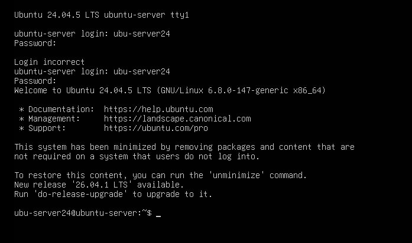
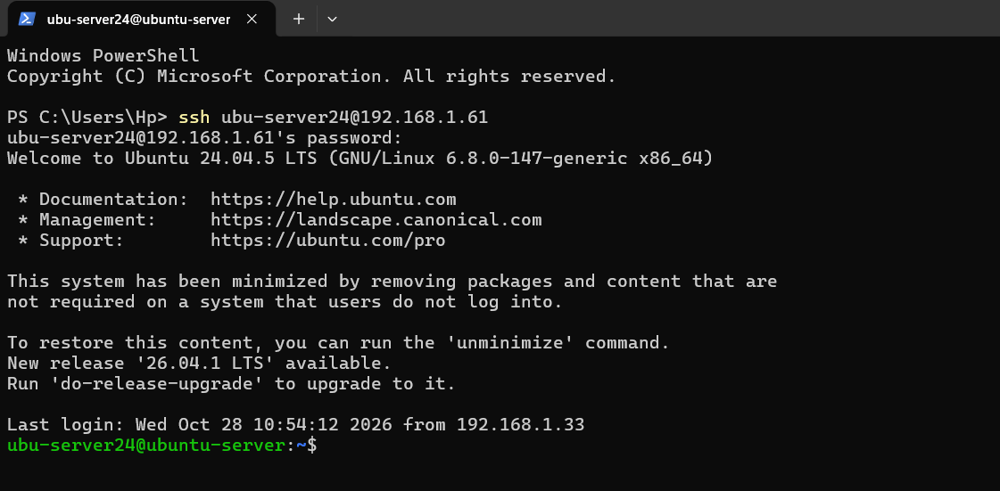
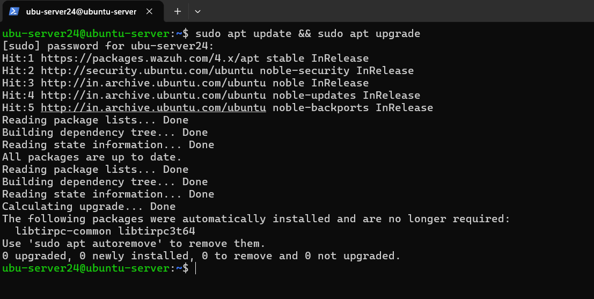
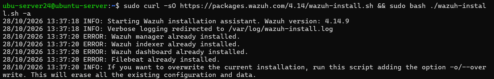
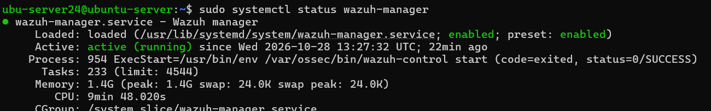
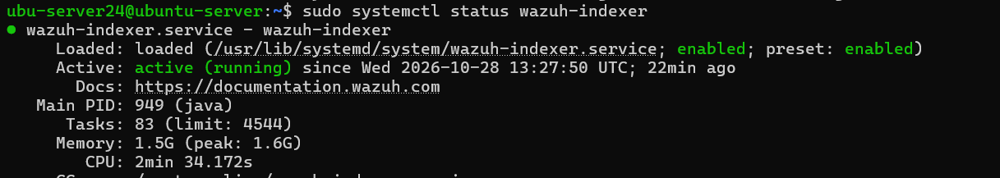
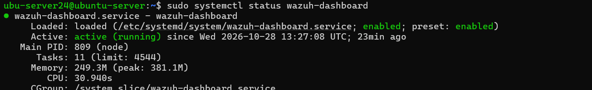
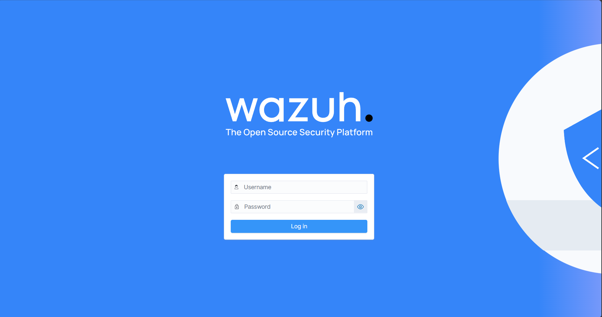

# 🛡️ Wazuh Server Installation Guide

## Step 1: Start Ubuntu Server VM

Start **VM1 — Ubuntu Server** in your virtualization software.

Log in using your Ubuntu Server credentials.

**Screenshot:** 


---

## Step 2: Configure SSH Access from Windows 11

For easier administration and better control, I used **SSH (Secure Shell)** to connect remotely to the Ubuntu Server VM from the Windows 11 host machine using PowerShell.

### 2.1 Install the SSH Server

Check whether the SSH service is installed and running:

```bash
sudo systemctl status ssh
```

If SSH is not installed, run:

```bash
sudo apt install openssh-server
```

Enable and start the SSH service:

```bash
sudo systemctl enable --now ssh
```

### 2.2 Find the Ubuntu Server IP Address

Run the following command on Ubuntu Server:

```bash
ip -4 addr
```

Identify the IPv4 address assigned to the server's network interface.

### 2.3 Connect from Windows 11

Open Windows PowerShell on the host machine and run:

```powershell
ssh <ubuntu-username>@<server-ip>
```

Replace `<ubuntu-username>` with your Ubuntu username and `<server-ip>` with your server's IPv4 address.

Enter your Ubuntu password when prompted.

Once connected, you can execute commands and administer the Ubuntu Server directly through PowerShell.

**Screenshot:** 


---

## Step 3: Update the Ubuntu Server

Update the package lists and upgrade installed packages:

```bash
sudo apt update && sudo apt upgrade
```

Wait for the process to complete before proceeding.

**Screenshot:** 


---

## Step 4: Download and Install Wazuh

Run the following command to download the Wazuh installation assistant and install the central components:

```bash
sudo curl -sO https://packages.wazuh.com/4.14/wazuh-install.sh && sudo bash ./wazuh-install.sh -a
```

**What does this command do?**

* `curl -sO` downloads the installation script.
* `wazuh-install.sh` is the Wazuh installation assistant.
* `-a` installs the central Wazuh components for a single-node deployment.

**Estimated installation time:** 10–20 minutes, depending on internet speed and VM resources.

Wait for the installation process to finish.

Wazuh has already been installed on my Ubuntu Server VM. However, some errors appeared during the installation process, as shown in the screenshot below. <br>
**Screenshot:** 


---

## Step 5: Save the Dashboard Credentials

After installation, the assistant provides the credentials required to access the Wazuh Dashboard.

Save the generated username and password securely.

**Security note:** Never publish your actual password or other sensitive credentials on GitHub. Redact them from screenshots before uploading.

---

## Step 6: Verify Wazuh Services

Check the status of each service.

### Wazuh Manager

```bash
sudo systemctl status wazuh-manager
```

### Wazuh Indexer

```bash
sudo systemctl status wazuh-indexer
```

### Wazuh Dashboard

```bash
sudo systemctl status wazuh-dashboard
```

Each service should show:

```text
Active: active (running)
```

Press `q` to exit each status screen.

### If a service is inactive

Investigate the service status and error logs first. If the service is stopped without an underlying fault, start it using the appropriate command:

```bash
sudo systemctl start wazuh-manager
sudo systemctl start wazuh-indexer
sudo systemctl start wazuh-dashboard
```

Verify the status again after starting the services.

---

## Step 7: Access the Wazuh Dashboard

On your Windows 11 host machine, open a web browser and enter:

```text
https://<WAZUH_SERVER_IP>
```

Replace `<WAZUH_SERVER_IP>` with your Ubuntu Server's actual IPv4 address.

For example:

```text
https://192.168.1.100
```

HTTPS normally uses port `443`, so specifying `:443` is optional.

**Screenshot:** 


Log in using the credentials saved in Step 5.

If a certificate warning appears, verify that you are connecting to your own lab server and understand the certificate configuration before proceeding.
