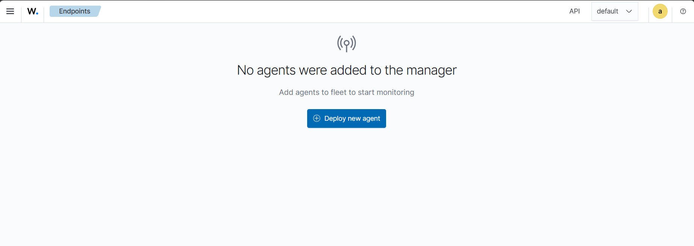
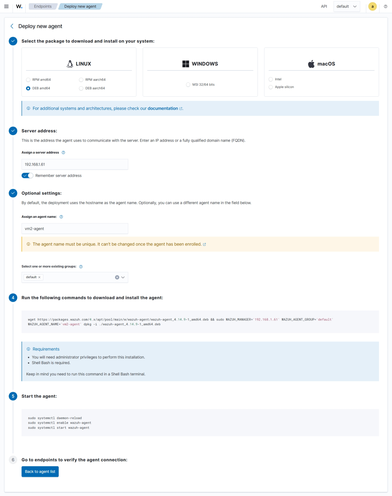
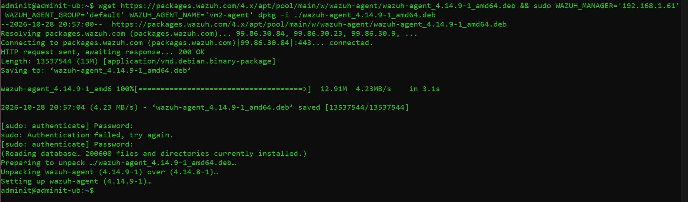
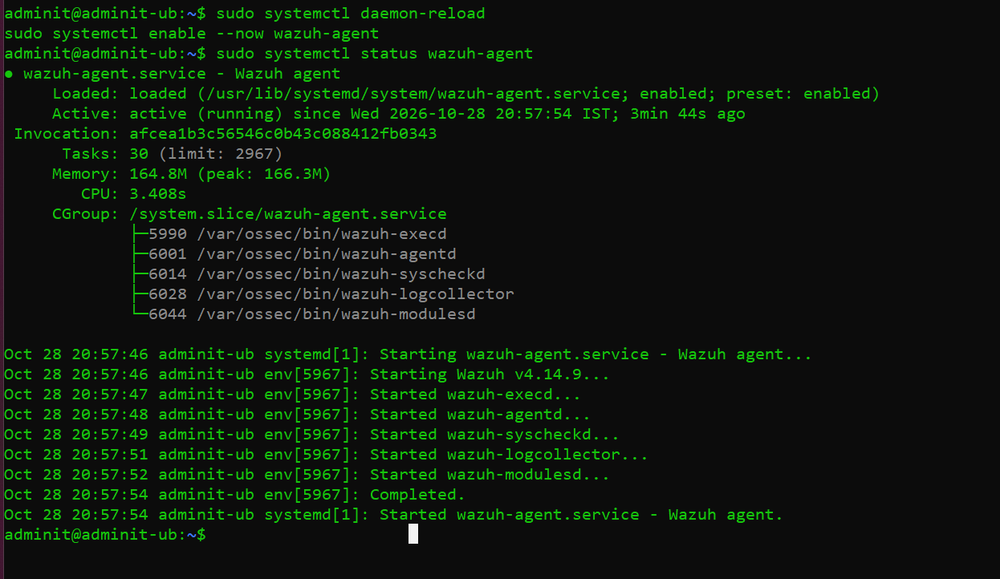
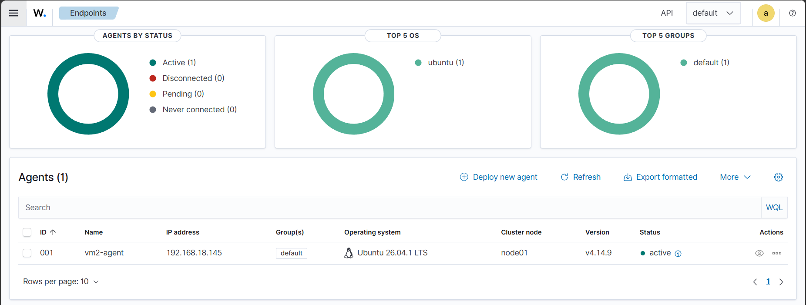

# 🐧 Wazuh Linux Agent Deployment

## 1. Overview

This guide explains how to deploy a Wazuh Agent on Ubuntu Desktop using the **Deploy new agent** functionality in the Wazuh Dashboard.

The Linux endpoint sends security events to the central Wazuh Server for monitoring, analysis, and alert generation.

## 2. Lab Environment

| Component         | Configuration            |
| ----------------- | ------------------------ |
| Virtual Machine   | VM2                      |
| Operating System  | Ubuntu Desktop 26.04 LTS |
| Agent Name        | `vm2-agent`   |
| Central Server    | Ubuntu Server VM1        |
| Agent Group       | `default`                |
| Deployment Method | Wazuh Dashboard          |

## 3. Prerequisites

Before deploying the agent, ensure that:

* The Wazuh Server is installed on VM1.
* The Wazuh Manager service is running.
* The Ubuntu Desktop VM is connected to the lab network.
* The Wazuh Server's static IPv4 address is known.
* The Ubuntu Desktop VM can communicate with the Wazuh Server.

## 4. Deployment Steps

### Step 1: Open the Wazuh Dashboard

On the Windows 11 host machine, open a web browser and navigate to:

```text
https://<WAZUH_SERVER_IP>
```

Replace `<WAZUH_SERVER_IP>` with the actual static IPv4 address of your Wazuh Server.

Log in using your Wazuh Dashboard credentials.

**Screenshot:** 


### Step 2: Open the Deploy New Agent Page

In the Wazuh Dashboard:

1. On first login wazuh-dashboard
2. Navigate to **Agents management**.
3. Select **Summary**.

4. Click **Deploy new agent**.

This opens the agent deployment wizard, where you can select the operating system and configure the new endpoint.

### Step 3: Configure the Linux Agent

Configure the deployment options as follows:

| Setting              | Value                             |
| -------------------- | --------------------------------- |
| Operating System     | Linux                             |
| Package              | DEB                               |
| Architecture         | AMD64, if supported by the VM     |
| Wazuh Server Address | Your server's static IPv4 address |
| Agent Name           | `vm2-agent`            |
| Agent Group          | `default`                         |

Select the package architecture that matches your Ubuntu Desktop installation. Most standard Intel and AMD computers use AMD64.

Enter the actual Wazuh Server IP address rather than a hostname that may not resolve inside your lab network.

**Screenshot:** 



### Step 4: Generate the Installation Command

After completing the configuration, the Wazuh Dashboard displays the commands required to install and configure the agent.

Review the generated commands and follow the instructions displayed by your dashboard.

**Important:** Use the commands generated by your installed Wazuh Dashboard. The exact commands may vary depending on the Wazuh version and selected configuration.

### Step 5: Install the Agent on Ubuntu Desktop

Start **VM2 — Ubuntu Desktop** and open a terminal.

Execute the installation commands generated by the Wazuh Dashboard.

Wait for the package installation and configuration to complete.

If the wizard separates installation and service activation into different commands, execute each command in the order provided.

**Screenshot:** 



### Step 6: Start and Enable the Wazuh Agent

After installation, enable and start the agent service:

```bash
sudo systemctl daemon-reload
sudo systemctl enable --now wazuh-agent
```

Check the service status:

```bash
sudo systemctl status wazuh-agent
```

The expected result is:

```text
Active: active (running)
```

Press `q` to exit the service status screen.

**Screenshot:** 



### Step 7: Verify the Agent in the Wazuh Dashboard

Return to the Wazuh Dashboard and navigate to:

**Agents management → Summary**

Find the agent named:

```text
vm2-agent
```

Wait for the agent to connect to the Wazuh Manager.

The agent should appear with an **Active** status.

**Screenshot:** 



### Step 8: Troubleshooting

Check server ipv4 address is correct:

```bash
sudo grep -n -A 5 '<server>' /var/ossec/etc/ossec.conf
```

If the agent does not become active, check the service:

```bash
sudo systemctl status wazuh-agent
```

Review the recent agent logs:

```bash
sudo tail -n 50 /var/ossec/logs/ossec.log
```

Check network connectivity to the Wazuh Server:

```bash
ping <WAZUH_SERVER_IP>
```

Replace `<WAZUH_SERVER_IP>` with the actual server address.

If the agent still cannot connect, verify the server address in the agent configuration, the Wazuh Manager status, and the network rules allowing agent communication.

The default Wazuh agent communication port is TCP 1514. Agent enrollment commonly uses TCP 1515 when enrollment is enabled and configured accordingly.

## 5. Expected Result

The Ubuntu Desktop VM is successfully deployed as a monitored endpoint when:

* The Wazuh Agent is installed.
* The agent service is running.
* The agent appears as Active in the Wazuh Dashboard.
* Expected Linux security events are received by the Wazuh Server.

## 6. Conclusion

The Ubuntu Desktop endpoint is now part of the Wazuh Home SOC Lab. It can be used to investigate Linux authentication events, monitor system activity, and practice security alert analysis.

**Next step:** Deploy the Wazuh Agent on VM3 (Windows 10) using the same dashboard-based deployment workflow.

## 7. References

* [Wazuh Agent Installation Guide](https://documentation.wazuh.com/current/installation-guide/wazuh-agent/index.html)
* [Wazuh Linux Agent Installation](https://documentation.wazuh.com/current/installation-guide/wazuh-agent/wazuh-agent-package-linux.html)
