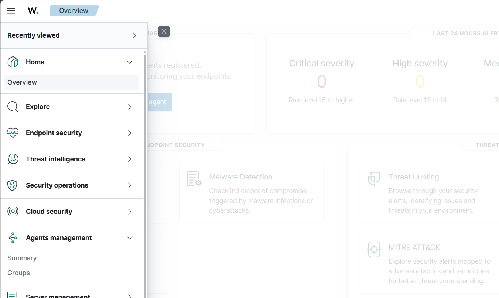
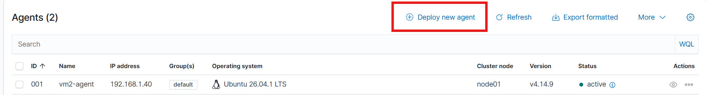
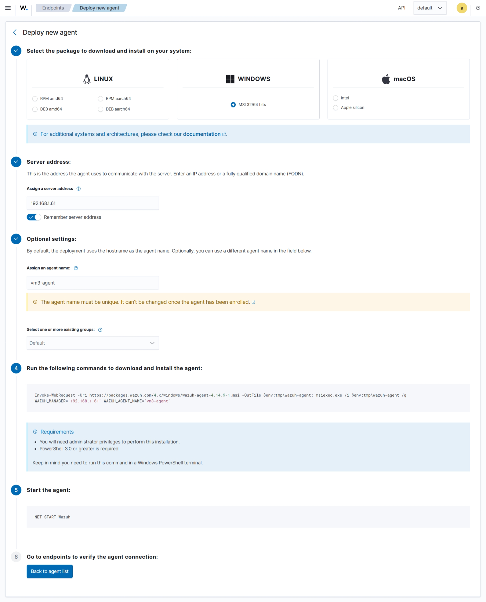
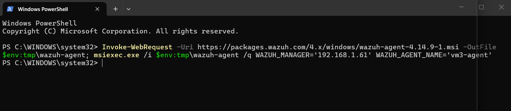
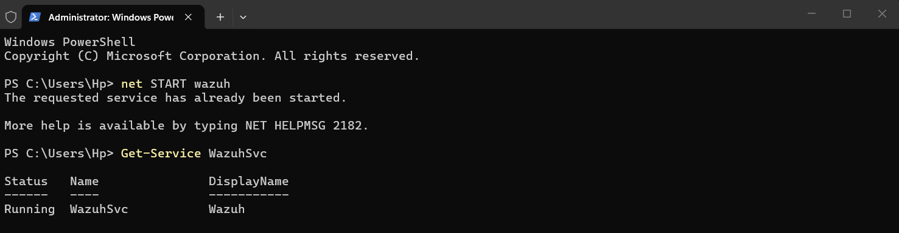
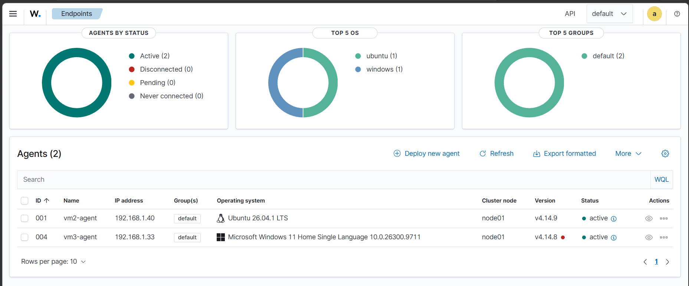

# Windows Agent Deployment

## 1. Objective

Deploy a Wazuh agent on the Windows 11 virtual machine using the **Deploy new agent** workflow in the Wazuh Dashboard.

The Windows endpoint will send security-related data to the Wazuh Manager for centralized monitoring and analysis.

## 2. Lab Environment

| Component       | Configuration       |
| --------------- | ------------------- |
| SIEM Platform   | Wazuh               |
| Wazuh Version   | 4.14.8              |
| Manager OS      | Ubuntu Server       |
| Endpoint OS     | Windows 11          |
| Agent Name      | `vm3-agent`         |
| Network         | Bridged             |
| Manager Address | `<WAZUH_SERVER_IP>` |

Replace `<WAZUH_SERVER_IP>` with the static IPv4 address of your Ubuntu Server.

## 3. Deploy a New Agent Through the Dashboard

### Step 1: Open the Wazuh Dashboard

1. Open the Wazuh Dashboard in a web browser.
2. Log in with your dashboard credentials.
3. Open the navigation menu.
4. Navigate to **Agents management → Summary**.



5. Click **Deploy new agent**.



### Step 2: Configure the Windows Agent

On the deployment configuration page:

1. **Select the operating system:** Windows.
2. **Select the architecture:** Choose the architecture appropriate for your Windows 11 VM.
3. **Configure the Wazuh server address:** Enter the static IP address of the Ubuntu Server running the Wazuh Manager.
4. **Configure the agent name:** Use `vm3-agent`.
5. **Configure the agent group:** Use the default group unless you have created another group for this endpoint.

Review the configuration before proceeding.

> **Important:** Use a Wazuh agent version compatible with your installed Wazuh Manager. This lab uses Wazuh 4.14.8, so verify the version selected by the dashboard before installation.

### Step 3: Generate the Installation Command

After configuring the deployment options, follow the instructions displayed on the dashboard.

The dashboard provides the Windows agent download and installation instructions for the selected configuration.

Copy the commands generated by your dashboard. Use those commands rather than a hard-coded example that might reference a different agent version.



*Figure: Windows agent deployment configuration page before installation.*

## 4. Install the Agent on Windows 11

### Step 1: Open PowerShell as Administrator

1. Start the Windows 11 virtual machine.
2. Open the Start menu.
3. Search for PowerShell.
4. Select **Run as administrator**.

### Step 2: Download and Install

Run the Windows agent download and installation commands provided by the Wazuh Dashboard.

Ensure that the installation uses the configured Wazuh Manager address and agent name.

If the dashboard provides a graphical installation option instead, follow its instructions and configure the same values during installation.



### Step 3: Start the Agent Service

After installation, open an elevated PowerShell session and run:

```powershell
net START wazuh
```

If the service starts successfully, verify its status using:

```powershell
Get-Service WazuhSvc
```

The expected status is `Running`.



*Figure: Starting the Wazuh agent service on Windows 11.*

## 5. Verify Agent Enrollment

1. Return to the Wazuh Dashboard.
2. Navigate to **Agents management → Summary**.
3. Locate `vm3-agent`.
4. Verify that its status changes to **Active**.

An Active status confirms that the agent has connected to the Wazuh Manager.

If the agent does not appear or remains disconnected, investigate the agent configuration, enrollment process, network connectivity and service logs.



*Figure: Windows agent entry and status in the Wazuh Dashboard.*

## 6. Troubleshooting

### Agent service is not running

Check the Windows service:

```powershell
Get-Service WazuhSvc
```

Review the Wazuh agent logs under the installation directory.

### Agent does not appear in the dashboard

Check the following:

* The configured Manager IP address is correct.
* The Windows VM can reach the Ubuntu Server.
* The Wazuh Manager is running.
* Agent enrollment has completed successfully.
* The required network ports are reachable.

The default ports commonly used for enrollment and communication are TCP 1515 and TCP 1514, respectively. TCP 55000 may be used for API-based enrollment.

### Agent remains disconnected

Review the agent logs and verify that the Windows endpoint can communicate with the Wazuh Manager over the configured protocol and port.

## 7. Results

Complete this section after testing the deployment.

| Verification               | Result  |
| -------------------------- | ------- |
| Windows agent installed    | Pending |
| Wazuh service running      | Pending |
| Agent visible in dashboard | Pending |
| Agent status Active        | Pending |

## 8. Next Steps

After confirming that the Windows agent is Active:

1. Verify that Windows security events are being collected.
2. Configure Sysmon in the lab, if required.
3. Generate safe test events on the Windows VM.
4. Investigate the resulting alerts in Wazuh.
5. Document the findings in the security investigation notes.
