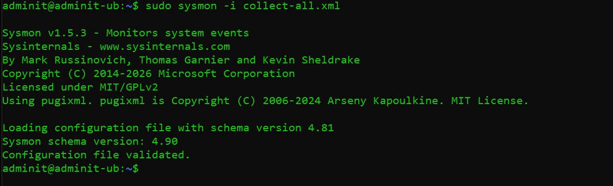
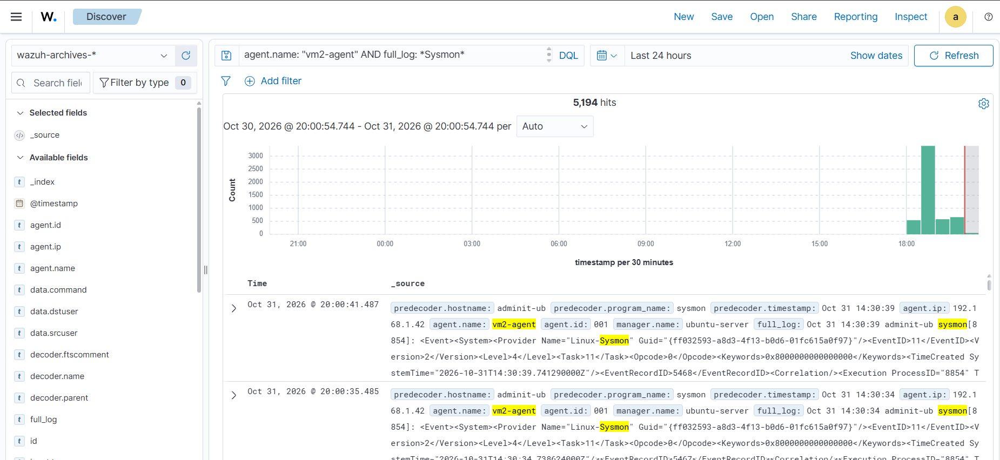

# Linux Sysmon Integration with Wazuh

## 1. Overview

Integrate Microsoft Sysmon for Linux with the Wazuh agent to monitor Linux endpoint activities, including process creation, network connections, and file operations.

## 2. Lab Environment

* SIEM: Wazuh 4.14.8
* Endpoint: Ubuntu 26.04
* Agent: vm2-agent (Wazuh Linux Agent)
* Monitoring Tool: Sysmon for Linux

## 3. Sysmon Installation

### Step 1: Add Microsoft Repository

Download and install the Microsoft repository package:

```bash
wget https://packages.microsoft.com/config/ubuntu/$(lsb_release -rs)/packages-microsoft-prod.deb

sudo dpkg -i packages-microsoft-prod.deb
```

### Step 2: Install Sysmon

Update the package repository and install Sysmon:

```bash
sudo apt-get update

sudo apt-get install sysmonforlinux
```

### Step 3: Download Sysmon Configuration

Download the `collect-all.xml` configuration:

```bash
wget https://raw.githubusercontent.com/microsoft/MSTIC-Sysmon/main/linux/configs/collect-all.xml
```

This configuration enables collection of supported Sysmon event types.

### Step 4: Install and Start Sysmon

Install Sysmon with the downloaded configuration:

```bash
sudo sysmon -i collect-all.xml
```



### Step 5: Verify Sysmon Installation

Check the service:

```bash
sudo systemctl status sysmon
```

## 4. Verify Sysmon Events

Monitor Sysmon events in Ubuntu:

```bash
sudo tail -f /var/log/syslog
```

For more readable output, use:

```bash
sudo tail -f /var/log/syslog | sudo /opt/sysmon/sysmonLogView
```

Generate some test activity:

```bash
whoami
```

```bash
ps aux
```

```bash
curl https://example.com
```

Check whether Sysmon records the generated activity.

## 5. Wazuh Agent Configuration

Verify that the Wazuh agent monitors `/var/log/syslog`.

Open the agent configuration:

```bash
sudo nano /var/ossec/etc/ossec.conf
```

Ensure the following configuration exists:

```xml
<localfile>
  <log_format>syslog</log_format>
  <location>/var/log/syslog</location>
</localfile>
```

Avoid adding a duplicate entry if this configuration already exists.

Restart the Wazuh agent if you made changes:

```bash
sudo systemctl restart wazuh-agent
```

Verify the agent:

```bash
sudo systemctl status wazuh-agent
```

## 6. Verify Events in Wazuh Dashboard

1. Open Wazuh Dashboard.
2. Navigate to Explore → Discover.
3. Select the `wazuh-archives-*` index pattern.
4. Set the time range to Last 24 hours.
5. Filter events using:

```text
agent.name: "vm2-agent"
```

Search for Sysmon-related events using:

```text
agent.name: "vm2-agent" AND full_log: *Sysmon*
```

Inspect the event details to verify the Sysmon event information.

