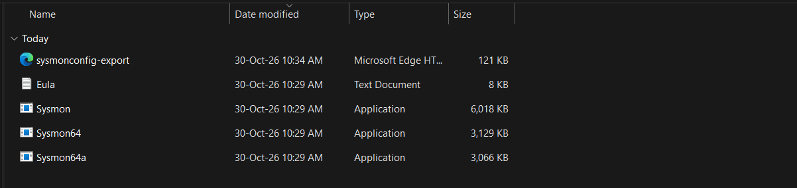
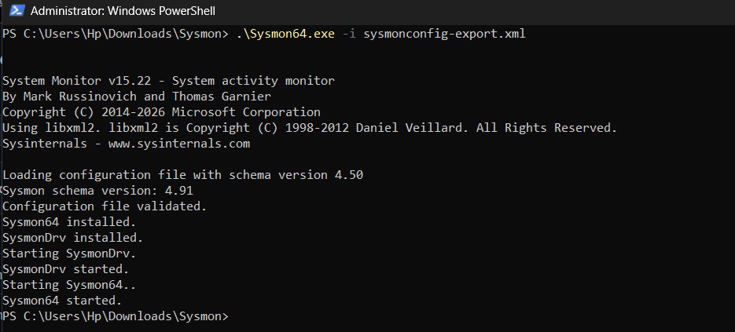
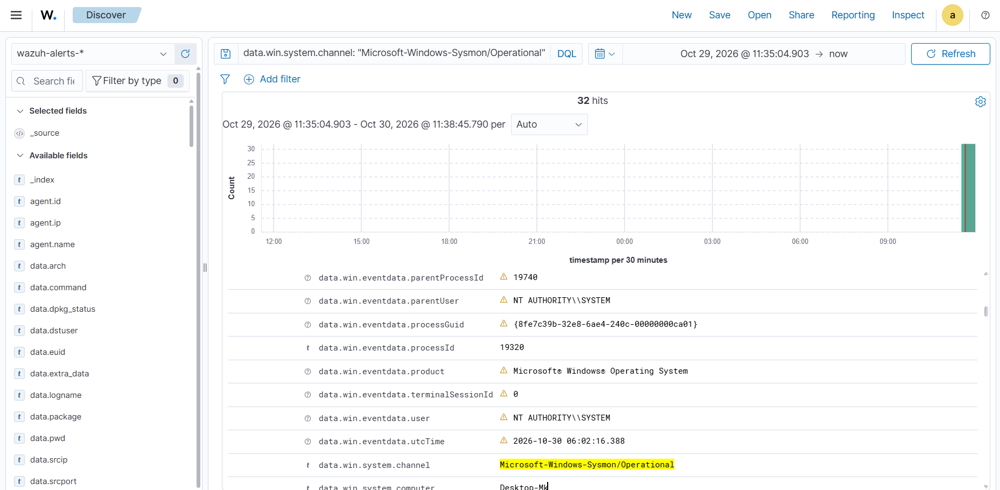

# Windows Sysmon Integration with Wazuh

## 1. Overview

Integrate Microsoft Sysmon with the Wazuh agent to collect and analyze Windows endpoint security events.

## 2. Lab Environment

* **SIEM:** Wazuh 4.14.8
* **Endpoint:** Windows 11
* **Agent:** vm3-agent (Wazuh Windows Agent)
* **Log Source:** Microsoft-Windows-Sysmon/Operational

## 3. Sysmon Installation

**Step 1:** Download Sysmon from the [official Microsoft Sysinternals website](https://learn.microsoft.com/en-us/sysinternals/downloads/sysmon).

**Step 2:** Download sysmonconfig-export.xml from the [Github page of SwiftOnSecurity](https://github.com/SwiftOnSecurity/sysmon-config/tree/master).

**Step 3:** Extract the sysmon in a folder and move the sysmonconfig-export.xml in this folder.



**Step 4:** Open powershell as Administratory and use cd cmd to go to location of extract sysmon folder. 

**Step 5:** Run the cmd for installing the sysmon.

```
.\Sysmon64.exe -i sysmonconfig-export.xml
```



## 4. Wazuh Agent Configuration

Edit the Wazuh agent configuration file:

`C:\Program Files (x86)\ossec-agent\ossec.conf`

If the file dosen't open then run wazuh-agent application in your windows as Administrator and go to  `View -> View config` to open ossec.conf.

Add the following configuration inside the existing `<ossec_config>` section:

```xml
<localfile>
  <location>Microsoft-Windows-Sysmon/Operational</location>
  <log_format>eventchannel</log_format>
</localfile>
```

Restart the Wazuh agent:

```powershell
Restart-Service WazuhSvc
```

## 5. Verification

Check the Sysmon service:

```powershell
Get-Service Sysmon64
```

Check recent Sysmon events:

```powershell
Get-WinEvent -LogName "Microsoft-Windows-Sysmon/Operational" -MaxEvents 10
```

To check whether the sysmonlogs in dashboard Open dashboard login and go to Explore>Discover and select the index `wazuh-archives-*` then Filter the logs using DQL:

`
data.win.system.channel: "Microsoft-Windows-Sysmon/Operational"
`


