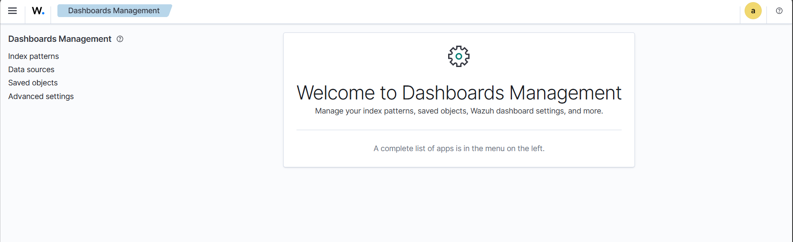
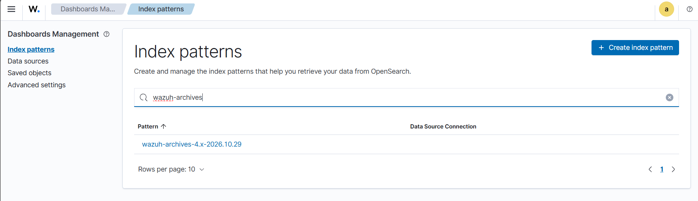
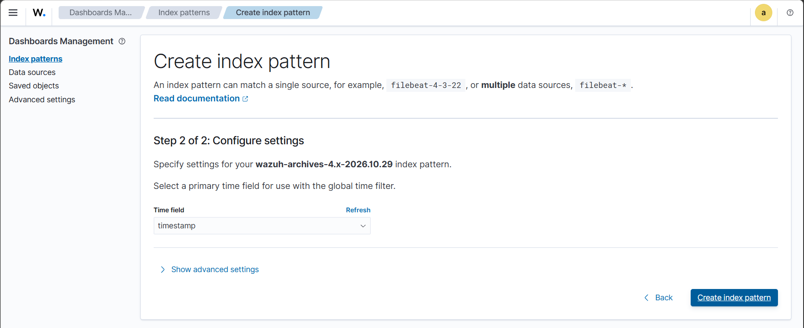

# Enable Wazuh Event Archiving

## Overview

In Wazuh 4.14.8, event archiving is disabled by default. This guide enables JSON archiving, configures Filebeat forwarding, and verifies Windows events in the Wazuh Dashboard.

## 1. Enable Archiving

Edit the Wazuh Manager configuration:

```bash
sudo nano /var/ossec/etc/ossec.conf
```

Inside the existing `<global>` section, set:

```xml
<logall>no</logall>
<logall_json>yes</logall_json>
```

Restart the manager:

```bash
sudo systemctl restart wazuh-manager
sudo systemctl status wazuh-manager
```

## 2. Enable Filebeat Forwarding

Edit the Filebeat configuration:

```bash
sudo nano /etc/filebeat/filebeat.yml
```

In the existing Wazuh module configuration, enable archives:

```yaml
filebeat.modules:
  - module: wazuh
    alerts:
      enabled: true
    archives:
      enabled: true
```

Restart Filebeat and test the output:

```bash
sudo systemctl restart filebeat
sudo systemctl status filebeat
sudo filebeat test output
```

## 3. Verify Archived Events

Check the archive directory:

```bash
sudo ls -lh /var/ossec/logs/archives/
sudo tail -n 5 /var/ossec/logs/archives/archives.json
```

Search for Windows agent events:

```bash
sudo grep -F 'vm3-agent' /var/ossec/logs/archives/archives.json | tail -n 5
```

If no events appear, verify agent connectivity and Windows event collection.

## 4. Create the Index Pattern

After archive events reach the indexer:

1. Open the Wazuh Dashboard.

2. Navigate to **Dashboard Management → Index patterns**.



3. Create the index pattern:

   `wazuh-archives-*`



4. Select `timestamp` as the time field.



Open Discover, select the archive index pattern, set the time range to **Last 15 minutes**, and search:

```text
agent.name: "vm3-agent"
```

## 5. Monitor Storage

Archiving all events can consume significant disk space.

```bash
df -h
sudo du -sh /var/ossec/logs/archives/
```

## Troubleshooting

* **No archive file:** Verify `logall_json` and Wazuh Manager status.
* **No Windows events:** Check agent connectivity and event collection.
* **No archive index:** Check Filebeat output and indexer status.
* **No dashboard results:** Expand the time range and verify the query.

## References

* [Wazuh Event Logging](https://documentation.wazuh.com/current/user-manual/manager/event-logging.html)
* [Wazuh Indexer Indices](https://documentation.wazuh.com/current/user-manual/wazuh-indexer/wazuh-indexer-indices.html)
